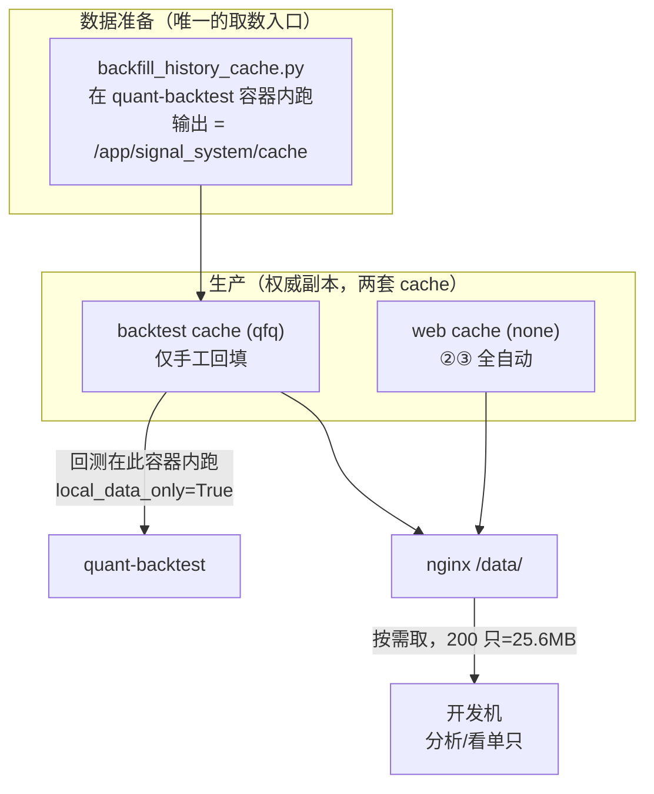

# 开发/生产数据分工：怎么取、缺了怎么触发（含对我上一条回答的更正）

日期：2026-10-16
状态：**分析，待拍板**（未改任何代码/配置）
前置：`docs/2026-10-16-行情数据分发设计.md`

## 0. 必须先纠正我上一条回答里的一个错误

上一条我说"生产侧日常增量已全自动，②③ 覆盖"，举的是 `scan_zero_axis` 的 bulk snapshot
与自动 bootstrap。**这对 web 侧成立，但对回测侧不成立** —— 现场有**两套 cache**：

| 容器 | 宿主目录 | 容器内路径 | `adjust` | 谁写它 |
|---|---|---|---|---|
| `quant-web` | `/opt/docker/quant/cache` | `/app/signal_system/cache` | **none** | ② 全市场快照 + ③ 自动 bootstrap |
| `quant-backtest` | `/opt/docker/quant/backtest-cache` | `/app/signal_system/cache` | **qfq** | **只有回填工具** |

（`docker-compose.oracle.yml:43` 与 `:75`；同一个容器内路径，**两个不同的宿主目录**）

**所以生产环境的两份数据深度不一样**，必须分开说：

| | 深度 | 靠什么涨 |
|---|---|---|
| web cache（none） | **5008 只 × 826 根**（实测 `000001_none.pkl`） | 每交易日收盘后 `scan_zero_axis` 自动 +1 行 |
| backtest cache（qfq） | **5008 只 × 2378 根**（实测 `000001_qfq.pkl`） | **仅** `backfill_history_cache.py` 手工跑 |

## 1. 回测侧是**刻意的网络隔离**，这是关键事实

`backtest_winrate.py` 的 preflight **强制**：

```python
"local_data_only": bool(local_data_only),                    # 必须 True
"fetch_missing_adjusted_disabled": not bool(fetch_missing_adjusted),   # 必须 True（即禁止自动拉）
```

`long_history_walk_forward_dataset.py` 同理，`line 367 "network_used": False`，
且 **`line 905` 缺数据直接抛错**：

```python
if missing:
    raise RuntimeError(f"missing QFQ history for candidate symbols: {missing[:5]}")
```

**即：回测链路的既定契约是"零网络、缺数据就地失败"。** 你问的
"生产环境没有的数据怎么触发获取" —— **回测侧就是故意不自动触发的**，
因为回测的可复现性依赖"数据确定性"，不能让一次回测偷偷去网上取数（数据会变）。

那不是缺陷，是设计。所以"触发获取"的正确位置是：**数据准备阶段**，不是回测运行时。

## 2. 回答你的两个问题

### Q1「开发环境要用数据怎么办，走 nginx 吗？」

**分两类，答案不同**：

**① 要跑回测/长历史研究** → **不要在开发机跑**，在 `quant-backtest` 容器里跑。
理由：preflight 要求 `local_data_only=True`，且它读的是 `/app/signal_system/cache`
（= 宿主 `backtest-cache`）。开发机就算把数据拉下来，也要再解决 `local_data_only`、
universe 冻结文件、index 哈希登记等一整套契约 —— **成本远高于直接在服务器跑**。
（本会话我一直是这么做的：流水线在服务器上、我只在本地看结果。）

**② 要在开发机做数据分析/看单只** → nginx 按需取，够用。
`curl -O` 单只 48KB；200 只 = 25.6MB（实测）。

**③ 要在开发机做全市场 SQL 查询** → nginx 给不了，见第 4 节。

### Q2「用到的数据生产没有，怎么触发获取？」

按数据来源分三种，触发方式完全不同：

| 情形 | 生产有吗 | 怎么补 | 自动化程度 |
|---|---|---|---|
| **日常新增交易日** | web 侧自动；backtest 侧静态 | backtest 侧需手工跑回填 | web 全自动；backtest 手工 |
| **更早的历史区间**（如回溯到 2016） | 两边都可能没有 | `backfill_history_cache.py --start/--end` | 手工，实测 9.05 s/只 |
| **新上市股票** | web 侧 ③ 自动 bootstrap；backtest 侧无 | backtest 侧要跑到才有 | web 自动；backtest 手工 |
| **新股票池/universe 变化** | 取决于池子 | 重建冻结 universe + manifest | 手工（有 SHA256 契约） |

**注意 backtest 侧没有任何自动触发机制** —— 这正是第 1 节说的"设计如此"。
所以"给生产环境触发获取"的答案是：

> **在 `quant-backtest` 容器里跑 `backfill_history_cache.py`**，
> 它的输出目录就是 `/app/signal_system/cache`（= 宿主 `backtest-cache`），
> 跑完数据就地可用，**不需要经过你的开发机**。

这样绕开 nginx，也绕开"先拉本地再传回去"的双倍搬运。

## 3. 但这里有个**真实缺口**（我上一条漏了）

`backtest-cache` 的更新**完全靠人工记得跑**。本会话我为补 2018–2022 跑了
74.3 分钟的全量回填；但**下一个交易日**它不会自动 +1 行。

后果：**回测数据会悄悄变陈旧**，而 preflight 里没有任何"数据到哪一天了"的检查项
（它只查 `data_adjustment_is_qfq`、`local_data_only`、`dataset_role_is_full` 等**口径**，
不查**新鲜度**）。

**建议补的（A 方案的一部分）**：
1. 一条可观测性：backtest cache 的"最新交易日 / 覆盖只数 / 缺口名单"
2. 在 §6 的调度里加一步：收盘后对 backtest cache 做**增量补齐**（不是全量，
   只补 `last_date < expected_trade_date` 的文件；本会话实测单只 9 秒，
   全市场增量会很久 —— 所以更实际的是**只补当日回测 universe 用到的那些**）

## 4. 另一个硬约束：backtest cache 一旦更新，**冻结清单全部失效**

`_qfq_history_manifest`（`backtest_winrate.py:579`）对 universe 里**每只**股票的
`{symbol}_qfq.pkl` 算 **sha256**（`line 591: hashlib.sha256(path.read_bytes())`），
产出 `qfq_history_manifest.jsonl`；随后 `long_history_walk_forward_dataset.py:743-780`
会**逐行重算并比对**，任何一行不符即 `ValueError("QFQ manifest row mismatch")`，
或把 `full_qfq_manifest_valid` 置 False。

**含义**：回测的可复现性锚定在"数据文件字节不变"上。所以

> 更新 `backtest-cache` ⇒ 所有已冻结的 dataset/manifest **全部失效**，需要重建。

这不是缺陷（正是它保证了"同一次回测可精确复现"，本会话的闸门对照能六格精确复现就靠这个），
但**它和 B 方案（自动增量补齐）直接冲突**：一旦自动补了当日行情，
昨天的 manifest 就对不上了。

**所以 B 方案必须限定边界**，例如：
- 只在**明确开启新研究批次**前补一次数据，补完立即重建 manifest；
- 或者给 backtest cache 分**版本化目录**（`daily_history@2026-10-16/`），
  研究批次锁定目录，新数据进新目录。
后者更干净，但需要改 `HISTORY_DIR` 的解析（现在是 `BASE_DIR/"cache"/"daily_history"`，固定值）。

**顺带一个已知隐患（与上一条同名）**：`path.read_bytes()` 算 sha256 **依赖行尾**。
本会话已因此踩过一次——`volume_unit_continuity_audit` 的
`market_data_sha_match: False` 就是"登记值恰是 CRLF 形、Linux 上永远红"。
pkl 是二进制、不受影响，但**任何把文本文件纳入此类哈希的地方都有同样风险**。

## 5. nginx vs PG：看你到底要什么

| 诉求 | nginx | PG |
|---|---|---|
| 取某 200 只的 pkl | ✅ 15.5MB / 200 次往返 | 40.8MB / 1 次往返 |
| 高延迟下（40ms RTT） | 往返开销 8.0s | 0.04s |
| **全市场筛选**（"2018-07-01 前 ≥270 根"） | ❌ 须先下 553MB | ✅ **0.056s** |
| 与既有架构冲突 | 无 | **有**：`自建数据库切换方案.md:363` 明确否决开发机直连生产库 |
| 存储成本 | 0（复用现有文件） | 2.2× 放大（实测 38MB→83MB） |

**结论不变**：要"取文件"用 nginx；要"查全市场"才需要 PG，且那是**设计变更**，
要先重新评估隔离决策（不是我该擅自做的）。

## 6. 推荐的分工



**三条规则**：
1. **取数只在一个地方发生**：`quant-backtest` 容器内跑回填 → 写 `backtest-cache`。
   开发机**不参与**取数，避免"先拉本地再传回生产"的双倍搬运与版本分叉。
2. **回测就在服务器跑**（契约要求 `local_data_only=True`），开发机只拿结果。
3. **开发机按需取**走 nginx，用于本地分析，不用于回测。

## 7. 待拍板

| 选项 | 内容 | 代价 |
|---|---|---|
| **A（推荐）** | 确立"取数只在 backtest 容器内"的规则 + 补两处可观测性（web/backtest cache 新鲜度）+ nginx 按需取 | 小，不碰 DB 隔离 |
| **B** | A + 收盘后自动对 backtest cache 做**增量补齐**（限定当日 universe） | 中，需要能容忍 9s/只 的耗时 |
| **C** | A + 打破 DB 隔离做只读副本（支持开发机全市场 SQL） | 设计变更，需重评 `自建数据库切换方案.md:363` |

**未做的事**：本文只分析。nginx 配置、可观测性接口、自动增量补齐都需先拍板。
