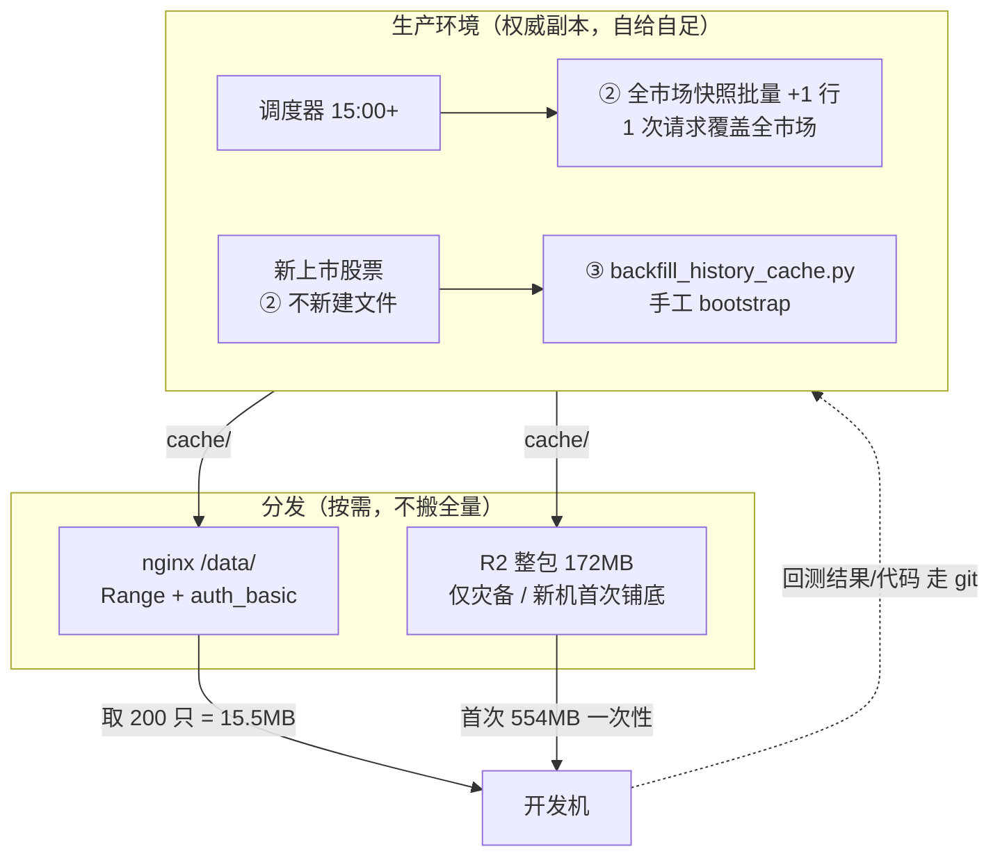

# 行情数据分发设计：新数据该拉到哪、要不要做页面接口

日期：2026-10-16
状态：**设计方案，待拍板**（本文只分析，未改任何代码/配置）

## 0. 先纠正一个前提

问："如果咱们的数据都是文本的形式，那可以使用 nginx"

**前提不成立 —— 数据是二进制 pickle，不是文本。**

```
cache/daily_history/000001_qfq.pkl 前16字节 hex: 80059502000100000000008c0670616e
可打印字符 3/16  -> 二进制
cache/index_000001_sh.pkl       前16字节 hex: 800595144c0000000000008c0670616e
可打印字符 4/16  -> 二进制
```

`8005` 是 pickle 协议 opcode。**但这不构成用 nginx 的障碍** —— nginx 传二进制和传文本一样好，
`application/octet-stream` 即可，还支持 Range。所以 nginx 方案依然成立，
**只是"因为是文本所以能用 nginx"这个理由要换掉**；真正的理由是"它能按需取单个文件"。

## 1. 先看清现状：数据其实有两类，更新频率完全不同

| 类别 | 位置 | 更新频率 | 单次增量 | 谁在用 |
|---|---|---|---|---|
| **日线历史** | `cache/daily_history/*.pkl` | 每交易日 1 次 | 每只 **+1 行**（~59 字节/行，但 **pkl 是整文件重写**） | 回测、scan、分析 |
| **分钟线** | 同目录（按需生成） | 盘中 | 按需 | 盘中监控 |
| **指数历史** | `cache/index_*.pkl` | 每交易日 1 次 | 每只 +1 行 | 市场闸门 |
| **接口缓存** | `cache/<sha256>.pkl` | 45s ~ 24h TTL | — | 各处，**自动重取，不用分发** |

关键事实（实测 `000001_none.pkl`）：**826 行 / 48530 字节**，即 **58.8 字节/行**。
所以"每天新增 1 行"≈ **59 字节**，但 pkl 序列化是**整文件重写**，
所以每天单只文件都要重传（~48KB）。

## 2. 现在的自动更新链路（读代码得出，非推测）

`data/market_data.py` 有三层，**互相独立**：

### ① 单只按需自愈（`get_bars`，1360 行）
```python
history = self.load_daily_history(symbol)
if not history.empty and len(history) >= min(limit, 120):
    last_date = ... history["datetime"].iloc[-1] ...
    if last_date >= self._latest_expected_trade_date():
        return history[...]                      # 够新 -> 直接用缓存
ttl = 45 if timeframe != "1d" else 4 * 3600
cached = self._cached(key, ttl)
if cached is not None: return cached              # 内存/磁盘缓存
frame = self._fetch_bars_with_fallback(...)       # 否则现拉
```
**这一层是自动的**：只要 `last_date < 最新应有交易日`，下一次访问该股票就会去拉。
**代价是每只一次网络往返**（实测 4.28 s/只；回填区间实测 9.05 s/只）。

### ② 全市场批量快照（`refresh_daily_histories_from_snapshot`，611 行）
把当日快照（东财 `f2/f17/f15/f16/f5/f6`，或新浪降级）**追加**到已存在的历史文件里。

**但第 616 行有一道闸**：
```python
if self.adjust not in ("", "none"):
    logger.info("复权模式下不把未复权批量快照写入历史，将按股票获取调整后日线")
    return 0
```
生产 `config.yaml:6` 是 `adjust: "none"` → **这道闸是开的**，批量快照**会**写入。
（回测侧 `config.yaml:255` 用 `qfq`，走的是"按股票拉取"那条路。）

还有两个前提：
- 第 614 行：**15:00 之前直接 return 0**（收盘前不追加）
- 第 696 行：`if not path.exists(): continue` —— **只更新已 bootstrap 过的文件，不新建**

### ③ 缺失/过短股票的**自动 bootstrap**（`scan_zero_axis`，`service.py:1057-1121`）
这一层我最初漏了，**它使"新数据"几乎全自动**：

```python
snapshot_updates = self.market.refresh_daily_histories_from_snapshot()   # ② 全市场 +1 行
bootstrap_complete = self.store.get_state("daily_bootstrap_complete", "false") == "true"
...
bootstrap_success  = set(json.loads(saved))          # 已 bootstrap 的股票，跨轮持久化
bootstrap_deferred = {...}                           # 取数失败的，按日期记录重试
remaining = [row for row in rows if ... not in bootstrap_success | deferred_today]
batch = remaining[: self.max_scan_symbols]           # 每轮最多 500 只
```
- 进度落在 state：`daily_bootstrap_complete` / `daily_bootstrap_success` / `daily_bootstrap_deferred`
- 每轮最多 **`max_scan_symbols_per_run: 500`** 只（`config.yaml:327`），**跨轮续跑**
- 用 `daily_history_is_usable(symbol, expected_trade_date, min_bars=60)` 判定"够用"，
  不够的进 `remaining` 重来 —— 所以**新上市股票会被自动补齐**
- 全市场 5026 只 ≈ **10 轮扫描**铺完，无需人工

### ④ 全量回填（`backfill_history_cache.py`）
手工工具，主要用于**补历史区间**（如本会话补 2018–2022），
实测 1318 只 / 74.3 分钟。
**日常增量不需要它** —— ②③ 已覆盖。

## 3. 核心结论：**"拉到哪"这个问题问错了 —— 生产环境必须能自给**

因为：
- **回测/scan 跑在服务器上**（`quant-backtest` 容器），它读的就是**服务器本地** `cache/`。
  数据只在你电脑上，服务器上的回测就用不到。
- 所以 **新数据的权威副本必须在生产环境**，这是硬约束，不是偏好。

由此，"先拉本地还是先拉生产"的答案是：**都可以先，但只有"生产先"能免费获得自愈**。
若你先拉本地，生产那份仍旧是旧的，直到你在生产上也跑一次拉取。

**而且生产侧的自愈能力已经存在，且比我想的更完整**：
- 收盘后跑一次 `scan_zero_axis` → ② 全市场快照**批量 +1 行**（1 次请求覆盖全市场）
- 同时 ③ 自动 bootstrap 那些缺失/过短的股票（每轮 500 只、进度持久化、跨轮续跑）
- 只有**补长历史区间**（如回溯到 2018）才需要 ④ 手工跑

**即：日常"有新数据"这件事，生产侧已经全自动了。** 这是本文最重要的结论。

## 4. 那到底还需不需要"页面拉取接口"

**结论：不需要。** 因为 A/B/C 三种诉求里，没有一种需要它：

### A. 让**生产**保持最新 → **已经完全自动**
② + ③ 覆盖。每天收盘后有一次 scan 就够了。
**唯一真实缺口是"看不见状态"**：没有任何地方显示"本机 cache 覆盖到哪一天、还差多少只"，
所以数据陈旧时无从察觉。**该补的是可观测性，不是按钮。**

### B. 让**开发机**按需取某几只 → **nginx 就够，不需要页面**
`location /data/` + `auth_basic`，`curl -O` 单只 48KB。
实测：200 只 = **25.6MB**。nginx 原生支持 Range
（`python -m http.server` **不支持**，实测返回 200 整文件，故不能拿它当文件服务器）。

### C. 让开发机能跑"全市场筛选" → 这是 **PG 独有能力**，属另一个议题（见第 5 节）

### 为什么"页面按钮"是个坏主意
1. **它只是把调度器已经做的事变成人工触发** —— 已有 ②③，按钮没有新增能力
2. **行为不明显**：`refresh_daily_histories_from_snapshot` 有 **15:00 闸**（第 614 行）
   且 1d 缓存 TTL 是 **4 小时**（第 1374 行），盘中点按钮大概率"看起来没反应"
3. **它会把长任务塞进请求生命周期** —— 全量 bootstrap 是 10 轮 × 500 只，
   与现有 `jobs` 体系的超时/重试语义冲突（现有任务的 timeout 是 0/60s/120s 三档）
4. 真要人工兜底，**CLI 已够**：`backfill_history_cache.py --start/--end`

## 5. PG 路线：数据已有一个只读副本，但不在你手上

实测（用本机 `quant-pg`，300 只 = 699006 行）：

| | pkl 文件 | PG |
|---|---:|---:|
| 取 200 只（8 列全） | 25.6 MB / **200 次往返** | 40.8 MB（二进制 COPY）/ **1 次往返** |
| 40ms RTT 折算往返开销 | **8.0 s** | **0.04 s** |
| 全市场筛选（2018-07-01 前 ≥270 根） | **做不到**（须先下 553MB） | **0.056 s** |
| 存储 | 38 MB | **83 MB（2.2×）** |
| 全市场装载 | — | **约 4 分钟 / 11.7M 行** |

**但**：`docs/自建数据库切换方案.md:363` 已明确否决开发机直连生产库
（`quant-db` 无 `ports:`、挂 `internal: true`，是刻意隔离）。
本会话那条反复用到的筛选（"2018-07-01 前 ≥270 根：0 只 → 1127 只"）
在 pkl 方案下必须先把 553MB 全下到本地 —— 这是 PG 唯一的、但很实在的优势。

## 6. 推荐设计



**要点**：
1. **权威副本在生产**（回测跑在服务器上，这是硬的）
2. **日常增量全自动**：生产侧 ②（全市场快照 +1 行）+ ③（缺失股票每轮 500 只自动补齐），
   **不需要任何人工或按钮**
3. **开发机按需取**：nginx，只取自己真正要跑的那几只（200 只 = 15.5MB，不是 553MB）
4. **首次/灾备**：R2 整包 172MB（已在 `docs/ops/sync-history-r2.sh` 实现并实测）
5. **不要**为"取文件"打破 DB 隔离；**要**做全市场 SQL 查询时再单独立项

**唯一建议补的缺口：可观测性**（未实施）
现在没有任何地方能回答"本机 cache 覆盖到哪一天、多少只、缺口在哪"，
所以**数据陈旧时无从察觉** —— 而 ③ 的 `daily_bootstrap_deferred` 里恰好已有这些信息，
只是没露出来。建议在现有结果页或一个只读接口暴露：
- 最新交易日 / 覆盖只数 / `daily_bootstrap_complete` 是否为 true
- `deferred` 名单与原因（哪些股票一直取不到）

## 7. 待拍板

| 选项 | 做什么 | 代价 |
|---|---|---|
| **A（推荐）** | nginx 按需取 + R2 铺底；生产侧靠现有 ②③ 自愈；只补可观测性 | 小；不碰 DB 隔离 |
| **B** | A + 一条 `--fetch-symbols` 命令包装（本地按名单批量拉） | 小 |
| **C** | A + **打破 DB 隔离**做只读副本，支持全市场 SQL | 设计变更，需重评隔离决策 |
| ~~D~~ | ~~在页面加"拉取新数据"按钮~~ | **不建议**：②③ 已覆盖，按钮无新增能力；15:00 闸 + 4h TTL 会让它"看起来没反应"；且把长任务塞进请求生命周期 |

**注意**：本文只做分析，**未改任何代码或配置**。A/B/C 都需要你选一个我再动手。
