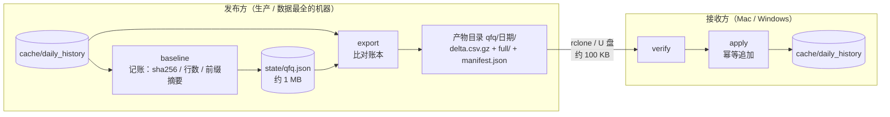

# 行情缓存增量同步方案

日期：2026-10-20
状态：**工具已实现并本地验证；服务端与 Mac 侧未接入**
配套代码：`quant-python/signal_system/cache_delta.py`
前置文档：`2026-10-16-行情数据分发设计.md`、`2026-10-16-开发生产数据分工.md`

## 0. 问题

`cache/daily_history/*.pkl` 的更新形态是「**追加 1 行、整个文件重写**」
（`market_data.py:refresh_daily_histories_from_snapshot` 对每只股票
`pd.concat` 后 `save_daily_history` 整文件落盘）。

后果：过一个交易日，所有文件的字节都变了，`rclone sync` 无法只传差异，
只能整包重传。实测规模：

| 项 | 实测值 |
|---|---|
| `cache/daily_history` 全量 | 10,018 文件 / 552.7 MB |
| 其中 qfq | 5,008 文件 / 380.9 MB |
| 打成 tar 分片（`sync-history-r2.sh`） | 173 MB（压缩到 31%） |
| **真实日增量（qfq 全市场各 +1 行）** | **5,008 行 / 80.4 KB（gzip）** |

即：每天为 80 KB 的真实变化重传 173 MB，比值约 2000:1。

## 1. 目标与非目标

**目标**
- 日常上传从 173 MB 降到 100 KB 量级
- 换新机器仍可用「一次全量基线 + 逐日增量」补齐
- 不改变任何研究/回测读取路径

**非目标（明确不做）**
- 不把 bar 改成数据库或列存（见 §2 理由）
- 不修改 `_qfq_history_manifest` 的字节哈希契约
- 不修改 `sync-history-r2.sh`（它继续负责全量基线包）
- 不改 `cache/daily_history` 的文件格式

## 2. 为什么不做成数据库

| 理由 | 依据 |
|---|---|
| 省不了体积 | 仓库既有实测：同样 bar，PG 存储是文件的 **2.2×**（38 MB → 83 MB） |
| gzip 已吃掉冗余 | 552.7 MB → 173 MB（31%），数值熵高，页压缩拿不到更多 |
| 破坏可复现契约 | manifest 按**文件**算 sha256 并逐行比对（`long_history_walk_forward_dataset.py:743-780`）；改行存储等于重建整套 preflight |
| 跨机不可用 | 生产库仅 internal 网络，开发机 `loopback:5432/quant` 门禁（`db-safety.mjs:34-46`） |

真正冗余的是 `output/backtests/_gate_samples/inputs`（756 MB，实测与 qfq 缓存**数值同源**），
那是"同数据存两遍"的问题，不是存储格式问题。本方案不处理它。

## 3. 设计



### 3.1 账本（state）

每只股票记四项：`sha256`、`rows`、`last`、`prefix`（前 N 行内容摘要）。

只存 64 字符摘要而不是整段数值：一只股票可达 2379 行，全存下来状态文件会到几百 MB。
实测 **5,008 只 → 1.0 MB**。

### 3.2 判定规则

| 当前文件 vs 账本 | 处理 |
|---|---|
| sha256 相同 | 跳过，**不解包** |
| 行数增加，且前 N 行摘要一致 | **只导出尾部新增行** → `delta.csv.gz` |
| 前 N 行摘要不一致（除权重述） | **整只替换** → `full/<symbol>.pkl` |
| 账本里没有该股票 | 整只替换，`reason=new` |

前缀摘要是对「追加 vs 重述」的唯一判据。除权会把整只历史重算，只有旧行未变才敢追加。

### 3.3 产物布局

```text
<out>/<variant>/<date>/
    delta.csv.gz      symbol,datetime,open,high,low,close,volume,amount,is_closed
    full/*.pkl        整只替换（与 cache 同名同格式）
    manifest.json     variant、计数、各文件 sha256
```

`variant` 为 `qfq` 或 `none`，按复权口径分目录。

### 3.4 apply 的三条护栏

| 情形 | 行为 |
|---|---|
| 目标机没有该标的缓存 | **拒绝**（rc=4）——绝不写只有 1 行的假历史 |
| 该日期已存在但数值不同 | **拒绝**（rc=4）——视为未声明的重述 |
| payload sha256 不符 | **拒绝**（rc=3），`verify` 同样拦 |

已存在且数值相同 → 跳过。因此重复应用同一增量是幂等的。

### 3.5 attrs 必须还原

`pd.concat` / `reset_index` 会丢掉 `DataFrame.attrs`，而下游审计靠
`attrs["adjust"] == "qfq"` 判口径。`apply` 显式保存并还原，否则整批缓存会被判为非 qfq。

## 4. 已验证（本地实测）

| 项 | 结果 |
|---|---|
| 全量 vs 增量（5,008 只 qfq） | 380.9 MB → **80.4 KB**，0 个 full |
| 单日 +1 只除权重述（300 只样本） | 299 行增量 6.1 KB + 1 只 full 0.1 MB |
| 数值等价性 | **300/300 全列全行一致**，dtype、列序、attrs 均保留 |
| `baseline` 耗时 | 216 s / 5,008 文件 |
| `export` 最坏耗时（全部变化） | 279 s / 5,008 文件 |
| 幂等重复应用 | 299 跳过、0 冲突 |
| 缺文件 / 冲突 / 篡改 | 分别 rc=4 / rc=4 / rc=3 |
| `none` 口径 | 通过 |

**未验证**：macOS 实机、服务端调度、与 `sync-history-r2.sh` 串联。

## 5. 已知限制

1. **应用后不是字节相同。** 实测每文件 +108 字节，纯序列化差异，数值一致。
   因此在发布方生成的 `_qfq_history_manifest` 在接收方校验不过 →
   **接收方应用完必须本地重新生成 manifest**，否则冻结研究报
   `QFQ manifest row mismatch`。
2. **补历史区间绕不开全量。** `backfill_history_cache.py` 会重写大量文件，
   属于基线重建，不是日常增量。
3. **`export` 是"相较上次记账的全部差异"，不是"某一天的行"。**
   `--date` 只是标签，不过滤数据。漏跑若干天后再跑，增量会一次包含多天。
4. **状态丢失不损坏数据**：所有标的都会判为 `full`，退回全量传输（安全降级）。

## 6. 落地步骤

见 `docs/TODO.md` 或本轮任务清单，分四个阶段：

- **A 工具收尾**（本地可完成）：补永久测试、`--date` 语义、索引
- **B 服务端接入**（需服务器）：确认更新入口、首次 baseline、挂调度、上传
- **C 客户端接入**：全量基线 → baseline → 每日 verify/apply → 重生成 manifest
- **D 运维**：监控告警、回退流程、定期基线重建

## 7. 待确认

1. 服务端每日行情更新由哪个流程触发、写入哪个目录
   （`/opt/docker/quant/cache` 与 `/opt/docker/quant/backtest-cache` 是两套）
2. 是否需要把测试纳入仓库测试套件
3. Mac 实机验证由谁执行、在什么时机

**本轮未改任何服务端配置，未接入调度，未修改 `sync-history-r2.sh`。**
