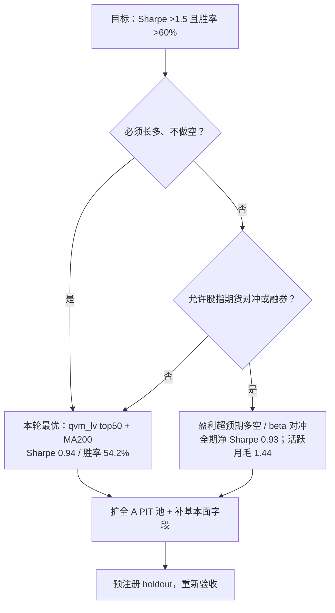

# 基本面与动量研究：数据、因子与可执行边界

日期：2026-11-05  
状态：**研究文档，不改变生产配置、不接券商、不下单**。  
配套产物：

- 结果 memo：[backtest-results/2026-11-05-fundamental-momentum/memo.md](backtest-results/2026-11-05-fundamental-momentum/memo.md)
- 独立验证：[verification.md](backtest-results/2026-11-05-fundamental-momentum/verification.md)
- 研究脚本：`quant-python/signal_system/fundamental_momentum_study.py`
- 原始结果：`summary.json`、`report.md`

---

## 0. 摘要

这轮研究想回答一个问题：**在 A 股，把基本面和动量组合起来，能不能做出夏普 >1.5、交易胜率 >60% 的策略？**

在本轮数据与约束下，答案是否定的：

| 口径 | 最优结果 | 目标 | 判定 |
|---|---:|---:|---|
| 长多（可执行） | Sharpe **0.94**，交易胜率 **54.2%** | >1.5 / >60% | 未达到 |
| 长多（不择时） | Sharpe 0.714，交易胜率 50.3% | >1.5 / >60% | 未达到 |
| 研究型多空（全期净） | Sharpe **0.928**，月度胜率 35.6% | >1.5 / >60% | 未达到 |
| 研究型多空（仅活跃月，毛） | Sharpe 1.437，月度胜率 68.5% | >1.5 / >60% | 接近，但不可执行 |

三个最重要的发现：

1. **12−1 价格动量在这个池子里失效**：IC 为 −0.0032，1 个月动量 IC 为 −0.0462（短期反转更强）。
2. **真正有效的是“盈利动量”**：近期 ROE 同比超预期（75 天窗口）IC 0.0516、ICIR 0.381、69.4% 的月份为正；这是 PEAD/盈利漂移的代理，不是价格趋势。
3. **长多的瓶颈是 beta 与回撤，不是选股**：加 MA200 风险开关能把回撤从 −32.5% 降到 −17.7%、Sharpe 提到 0.94，但平均暴露只剩 54.7%，交易胜率 54.2%，仍达不到 60%。

**结论：如果“动量”指价格动量，这条路在本样本里不成立；如果指盈利动量，它有效但事件型、间歇型，长多收益被现金月和 beta 拖累。** 想继续提高，优先扩池/补基本面/加对冲，而不是在同一批股票上扫参数。

---

## 1. 研究边界

| 项 | 本轮设定 |
|---|---|
| 股票池 | 300 只当前上市 A 股，29 个申万一级行业；期末流通市值中位数 138.5 亿元 |
| 样本 | 2018-01-31 → 2026-08-31，104 个月末信号；权益按行情末端 2026-10-30 盯市 |
| 调仓 | 月末收盘算信号，下一交易日开盘执行；月度换仓 |
| 约束 | 长多、不加杠杆、不做空、T+1、整手 100 股 |
| 成本 | 佣金 3bp（最低 5 元）、卖出印花税 10bp、滑点 5bp |
| 资金 | 25 万元 |
| 目标 | Sharpe >1.5，交易胜率 >60% |

明确不在本轮范围：

- 不做日内、不做 T0、不做高频、不做订单流。
- 不做券商接入、不自动下单。
- 不把研究型多空当作可执行策略；A 股散户的融券可得性和成本不满足。
- 不把 2025–2026 当作盲测；该区间已被其他研究线查看过。

---

## 2. 数据与 PIT 口径

### 2.1 数据文件

| 数据 | 文件 | 说明 |
|---|---|---|
| 财务 | `D:/tmp/fund300/financial_real.jsonl` | 28,056 条季度记录；精确公告日 3,901 条，估算 24,155 条 |
| 行情 | `quant-python/signal_system/cache/daily_history` | 300/300 只前复权日线，35.2 MB |
| 市场 | `D:/tmp/fund300/market.jsonl` | 2018–2026 日度 PE、流通市值 |
| 股票池 | `D:/tmp/fund300_symbols.json` | 300 只 |
| 行业 | `D:/tmp/fund300_industry.json` | 申万一级行业 |

### 2.2 PIT 规则

财务数据最容易出前视偏差，本轮采用保守口径：

- **精确公告日**（`ann_date_estimated=False`）：直接使用公告日。
- **估算公告日**（`ann_date_estimated=True`）：推迟到法定披露截止日：
  - Q1：4 月 30 日
  - 半年报：8 月 31 日
  - Q3：10 月 31 日
  - 年报：次年 4 月 30 日
- 如果公告日早于报告期结束，强制改为报告期结束后的第一天。
- 报告必须在信号日**严格之前**可用；公告日恰好等于月末信号日时，当天不使用新报告。

独立验证用 `000008` 做了真实数据边界检查：

| 信号日 | 面板使用的报告期 | 是否使用 2024Q1 |
|---|---|---|
| 2024-04-30 | 2023-12-31 | 否（公告日恰为信号日） |
| 2024-05-31 | 2024-03-31 | 是 |

### 2.3 已知偏差

- **幸存者偏差**：300 只是当前上市股票，没有退市股；不是全 A PIT 池。
- **样本偏 mid/large cap**：期末流通市值中位数 138.5 亿元，小盘/微盘覆盖不足。
- **财务字段有限**：只有 ROE、资产负债率、PE/流通市值；没有营收/利润增速、现金流质量、应计、分析师预期修正。
- **2025–2026 非盲测**：已被其他研究线查看。
- **多空不可执行**：未计融券费、借券可得性、冲击成本。

---

## 3. 因子定义

所有因子在每个月末做横截面百分位排名（0–1，越大越好）；排名在全样本上计算，选股时再叠加可交易过滤。

| 因子 | 公式/定义 | 方向 | 经济含义 |
|---|---|---|---|
| `mom_12_1` | `P(t−21) / P(t−252) − 1` | 高好 | 12−1 价格动量 |
| `mom_6_1` | `P(t−21) / P(t−126) − 1` | 高好 | 6−1 价格动量 |
| `mom_3_1` | `P(t−21) / P(t−63) − 1` | 高好 | 3−1 价格动量 |
| `mom_1` | `P(t) / P(t−21) − 1` | 高好 | 1 个月动量（实际是短期反转） |
| `vol_60` | 过去 60 日收益标准差 × √252 | 低好 | 低波动 |
| `earnings_yield` | `1 / PE`，截断到 [−0.5, 0.5] | 高好 | 价值（盈利收益率） |
| `roe` | 最新报告 ROE | 高好 | 质量/盈利能力 |
| `debt_ratio` | 最新报告资产负债率 | 低好 | 财务风险 |
| `roe_yoy` | 同季度 ROE 同比变化 | 高好 | 盈利动量 |
| `earnings_surprise_75` | 近 75 天内有新报告时的 `roe_yoy`，否则缺失 | 高好 | 盈利超预期/PEAD |
| `earnings_surprise_90` | 同上，90 天窗口 | 高好 | 同上 |
| `earnings_surprise_120` | 同上，120 天窗口 | 高好 | 同上 |
| `quality` | `0.5×rank(roe) + 0.5×rank(−debt_ratio)` | 高好 | 质量复合 |
| `value` | `rank(earnings_yield)` | 高好 | 价值 |
| `momentum` | `rank(mom_12_1)` | 高好 | 价格动量 |
| `low_vol` | `rank(−vol_60)` | 高好 | 低波 |
| `qvm_lv` | `0.4×momentum + 0.2×quality + 0.2×value + 0.2×low_vol` | 高好 | 本轮主复合 |

可交易过滤：

- 价格 ≥ 1 元；
- 流通市值 ≥ 20 亿元；
- 12−1 动量、盈利收益率、ROE、资产负债率均非空；
- 最新报告距报告期 ≤270 天。

---

## 4. 因子表现

### 4.1 Rank IC

| 因子 | IC 1M | ICIR 1M | 正 IC 月占比 | IC 3M |
|---|---:|---:|---:|---:|
| 12−1 价格动量 | −0.0032 | −0.018 | 48.5% | −0.0180 |
| 6−1 价格动量 | −0.0247 | −0.140 | 46.5% | −0.0156 |
| 3−1 价格动量 | −0.0230 | −0.137 | 40.6% | −0.0105 |
| 1 个月动量 | −0.0462 | −0.343 | 37.6% | −0.0423 |
| 60 日波动率 | −0.0655 | −0.315 | 35.6% | −0.0967 |
| 盈利收益率 | 0.0182 | 0.100 | 53.5% | 0.0154 |
| ROE | 0.0246 | 0.138 | 55.4% | 0.0108 |
| 资产负债率 | −0.0110 | −0.102 | 46.5% | −0.0099 |
| ROE 同比 | 0.0169 | 0.136 | 59.4% | 0.0093 |
| **盈利超预期 75d** | **0.0516** | **0.381** | **69.4%** | **0.0414** |
| 盈利超预期 90d | 0.0456 | 0.326 | 66.7% | 0.0368 |
| 盈利超预期 120d | 0.0279 | 0.204 | 62.2% | 0.0145 |
| 质量 | 0.0268 | 0.219 | 55.4% | 0.0172 |
| 价值 | 0.0182 | 0.100 | 53.5% | 0.0154 |
| **复合 qvm_lv** | **0.0363** | **0.201** | **60.4%** | **0.0370** |

ICIR = 月度 IC 均值 / IC 标准差；不是策略信息比率。

### 4.2 解读

- **价格动量不是“正 IC 弱”，而是方向为负**。在这个池子里，过去 12 个月涨得多的股票，未来 1 个月并不占优；1 个月动量甚至是显著反转。
- **低波动方向明确**：波动率 IC 为 −0.0655，说明低波组未来收益更高；但低波本身是慢因子，单独做多 Sharpe 只有 0.4–0.7。
- **质量/价值方向为正但弱**：ROE 0.025、EP 0.018，单独使用不足以支撑高 Sharpe。
- **盈利超预期是唯一强信号**：75 天窗口 IC 0.052、ICIR 0.38、69% 月份为正；但信号只在财报季附近密集，平时大量月份没有足够样本。
- **复合 qvm_lv 的 IC 0.036** 主要来自低波和质量，而不是价格动量；这也解释了为什么“基本面+动量”听起来合理，实际收益却主要不是动量贡献。

---

## 5. 组合回测

### 5.1 长多

| 组合 | CAGR | Sharpe | 最大回撤 | 月度胜率 | 交易胜率 | 笔数 | 平均暴露 |
|---|---:|---:|---:|---:|---:|---:|---:|
| qvm_lv top20 | 11.79% | 0.625 | −33.51% | 57.1% | 51.1% | 595 | 97.1% |
| qvm_lv top30 | 13.81% | 0.714 | −32.54% | 55.2% | 50.3% | 763 | 97.0% |
| qvm_lv top50 | 13.21% | 0.692 | −32.04% | 56.2% | 51.6% | 1,062 | 95.6% |
| quality top20 | 6.76% | 0.405 | −34.02% | 49.5% | 47.1% | 223 | 96.2% |
| value top20 | 6.80% | 0.420 | −35.21% | 47.6% | 54.2% | 253 | 98.4% |
| 盈利超预期 75d top20 | 5.62% | 0.394 | −41.49% | 36.2% | 49.2% | 484 | 51.8% |
| 盈利超预期 90d top20 | 7.89% | 0.501 | −43.43% | 38.1% | 50.5% | 493 | 55.1% |
| **qvm_lv top50 + MA200** | **14.55%** | **0.940** | **−17.74%** | 39.0% | **54.2%** | 825 | 54.7% |
| qvm_lv top30 + MA200 | 14.53% | 0.924 | −20.71% | 39.0% | 53.6% | 560 | 55.3% |
| qvm_lv top30 + MA60 | 6.36% | 0.498 | −21.06% | 39.0% | 46.6% | 760 | 45.6% |

要点：

- 不择时的长多最好 Sharpe 0.714，回撤 −32.5%。
- 加 MA200 风险开关后，Sharpe 0.94、回撤 −17.7%，但平均暴露 54.7%、月度胜率 39%（空仓月不计正收益）。
- 所有长多版本的**交易胜率都低于 60%**；最高 54.2%。
- 年换手 4.09x，按成本估算年成本约 0.53%；`min_cash=125.96`，全程现金非负，825 笔卖出全部整手。

### 5.2 研究型多空（盈利超预期）

| 组合 | 活跃月 | 毛年化 | 全期毛 Sharpe | 全期毛胜率 | 扣费净年化 | 全期净 Sharpe |
|---|---:|---:|---:|---:|---:|---:|
| 75d Q5 | 49/104 | 8.72% | 0.955 | 28.8% | 7.87% | 0.869 |
| 75d Q10 | 49/104 | 10.64% | 0.915 | 32.7% | 9.79% | 0.847 |
| 90d Q5 | 54/104 | 8.36% | 0.836 | 31.7% | 7.43% | 0.746 |
| **90d Q10** | **54/104** | **12.20%** | **0.999** | 35.6% | **11.26%** | **0.928** |
| 120d Q10 | 75/104 | 11.43% | 0.777 | 44.2% | 10.14% | 0.690 |

- 90d Q10 的**活跃月**毛 Sharpe 1.437、胜率 68.5%；但活跃月只有 54/104，其余月份按现金计入后全期 Sharpe 0.999。
- 扣 0.15%/月（双边成本近似）后全期净 Sharpe 0.928。
- 这不是可执行的 A 股散户策略：需要做空、融券费、借券可得性和冲击成本。

### 5.3 子区间稳定性

从同一全期权益曲线切片：

| 区间 | CAGR | Sharpe | 最大回撤 | 月度胜率 | 交易胜率 |
|---|---:|---:|---:|---:|---:|
| 2018–2024 | 12.76% | 0.87 | −15.84% | 34.9% | 52.3% |
| 2025–2026 | 23.52% | 1.27 | −17.74% | 57.1% | 57.6% |
| 全期 | 14.55% | 0.94 | −17.74% | 39.0% | 54.2% |

2025–2026 是偏乐观的子区间，但即使在这里，Sharpe 1.27、交易胜率 57.6%，仍未达到 1.5/60%。同期 300 只等权股票池：CAGR 11.76%、Sharpe 0.55、最大回撤 −27.78%；最优长多跑赢等权池，但离目标还远。

---

## 6. 为什么价格动量失效、盈利动量有效

### 6.1 价格动量

- A 股中短期反转效应强，12−1 动量在 2018–2026 的 300 只样本上没有正 IC。
- 这个池子里 mid/large cap 占比高，趋势持续性弱于小盘题材股；行业轮动和风格切换会打断个股趋势。
- 用价格动量选股，本质上是在买“过去涨得多”的股票；在反转市场里，这会把组合推向高波动、高拥挤的标的。

### 6.2 盈利动量

- 近期 ROE 同比超预期反映的是**基本面信息扩散**：财报公布后，市场需要时间消化，形成 PEAD。
- 75 天窗口比 90/120 天更强，说明信号衰减很快；超过一个季度后，信息优势基本消失。
- 它是**事件型**信号：财报季密集，非财报季稀疏；这导致策略无法全年满仓，年化 Sharpe 被现金月拉低。
- 它不是“趋势动量”，不能和价格动量混为一谈；两者相关性很低，甚至方向相反。

### 6.3 质量/价值/低波

- 方向为正，但 IC 只有 0.02–0.03；单独做多 Sharpe 0.4–0.7。
- 低波是复合里最稳定的贡献，但低波组合的收益弹性有限，难以单独达到高 Sharpe。
- 质量/价值更适合做**过滤器**或**风险降级**，而不是收益引擎。

---

## 7. 对策略设计的含义

### 7.1 决策树



### 7.2 如果坚持长多、可执行

当前最优架构：

- 股票池：300 只 mid/large cap；
- 选股：`qvm_lv` top50；
- 风险开关：等权股票池 > MA200 才持有，否则现金；
- 调仓：月度；
- 成本：3bp 佣金 + 10bp 印花税 + 5bp 滑点；
- 预期：CAGR 14.55%、Sharpe 0.94、最大回撤 −17.74%、交易胜率 54.2%。

这不是 1.5/60% 的策略，但它是一个**可解释、可复现、成本后仍为正**的基线。要把它变成候选生产策略，还需要：

1. 扩到全 A PIT 池（含退市股），消除幸存者偏差；
2. 补营收/利润增速、现金流质量、应计、ROIC、分析师预期修正；
3. 做行业中性化和风格暴露归因；
4. 预注册 2026 之后的 holdout，只查看一次；
5. 做 6–12 个月纸面/模拟盘，只验证数据和执行链路，不根据结果调参。

### 7.3 如果目标是高 Sharpe

当前样本只有两条路：

- **盈利超预期多空**：全期净 Sharpe 0.93，活跃月毛 1.44；需要做空/融券，A 股散户不可行。
- **长多 + 股指期货对冲**：用 IF/IC 对冲 beta，把长多的市场 beta 拿掉；本轮未做正式回测，不能声称能到 1.5。

即使走这两条路，也要先解决：

- 更好的盈利超预期数据（分析师预期、营收/利润超预期，而不只是 ROE 同比）；
- 事件时点（公告日盘后/次日）和成交可行性；
- 对冲成本、基差、保证金和展期。

### 7.4 如果目标是高胜率

“胜率 >60%”与“动量”天然不完全兼容：

- 趋势/动量策略通常胜率 40–55%，靠盈亏比赚钱；
- 高胜率往往来自短持有期、止盈、均值回归/反转；
- 当前样本里 1 个月动量 IC 为负，说明反转确实更强；如果要做高胜率，应单独研究“质量/价值 + 超卖反转 + 短持有期”，而不是把价格动量硬改成高胜率。

这条线本轮没有做；它是一个独立的研究方向，不能和本报告的动量结论混在一起。

### 7.5 如果和 ETF 核心—卫星结合

ETF 核心—卫星线目前 Sharpe 1.07–1.20（取决于波动目标），股票长多线 Sharpe 0.94；两者相关性、容量和叠加后的回撤都未测。可以作为下一步：

- 股票 sleeve 作为卫星，ETF 核心作为防守；
- 先测 10%/20%/30% 股票 sleeve 的边际贡献；
- 要求叠加后 Sharpe 提升、回撤不恶化、换手和容量可接受。

本轮没有做这个叠加，不能给结论。

### 7.6 不建议

- 在同一 300 只股票上继续扫因子窗口/权重/持仓数，直到 Sharpe >1.5；这是样本内过拟合。
- 用 12−1 价格动量作为核心信号；本样本方向为负。
- 忽略 PIT、幸存者偏差和 2025–2026 非盲测。
- 把研究型多空的“活跃月 Sharpe 1.44”当成可执行策略 Sharpe；全期净只有 0.93。

---

## 8. 下一步实验清单

按信息增益排序，而不是按“看起来最容易出高 Sharpe”排序：

| 优先级 | 实验 | 需要的数据 | 成功标准 |
|---:|---|---|---|
| P1 | 全 A PIT 池 + 退市股 | 历史成分、退市日期、真实公告日 | 消除幸存者偏差后，因子 IC 方向不反转 |
| P1 | 盈利超预期事件研究 | 公告日、营收/利润同比、分析师预期 | 事件后 20/60 日超额收益，跨窗口一致 |
| P2 | 长多 + 股指期货对冲 | 指数期货日线、基差、保证金 | 对冲后 Sharpe 提升，回撤下降 |
| P2 | 质量/价值 + 超卖反转 | 短周期价格、质量过滤 | 胜率 >60% 且成本后 Sharpe >1.0 |
| P3 | 股票 sleeve + ETF 核心 | 两条线的日权益 | 叠加后 Sharpe 提升、回撤不恶化 |
| P3 | 行业中性化/风格归因 | 行业分类、风格因子 | 收益不是单一行业/风格暴露 |

每个实验都必须预先写清楚：样本区间、因子方向、分组方式、成本、成功标准、holdout 只看一次。否则又会回到“开发期 7/8 改善、holdout 1/3”的老路。

---

## 9. 复现

```bash
cd quant-python/signal_system

python fundamental_momentum_study.py \
  --data-dir D:/tmp/fund300 \
  --price-dir cache/daily_history \
  --symbols-file D:/tmp/fund300_symbols.json \
  --out D:/tmp/fundmom_study

python -m pytest tests/test_fundamental_momentum_study.py -q
```

验证记录：[verification.md](backtest-results/2026-11-05-fundamental-momentum/verification.md)。  
重跑 `summary.json` 哈希一致；IC、多空序列、最优长多均独立复算；PIT 边界、整手/现金不变量通过。

---

## 10. 结论

- **价格动量在本样本里不成立**；12−1 动量 IC 为负，1 个月动量是反转。
- **盈利动量（近期 ROE 同比超预期）是唯一强信号**，但事件型、间歇型，长多收益被现金月和 beta 拖累。
- **长多最优 Sharpe 0.94、交易胜率 54.2%**；研究型多空全期净 Sharpe 0.928，活跃月毛 1.44，但不可在 A 股散户约束下执行。
- **1.5/60% 在本轮数据与约束下没有达到**；没有为了凑目标调参。
- 下一步优先扩池、补基本面、做对冲/事件研究，而不是继续在同一批股票上扫参数。

**生产动作：none。** 不改 `config/config.yaml`，不改三策略，不接券商。
